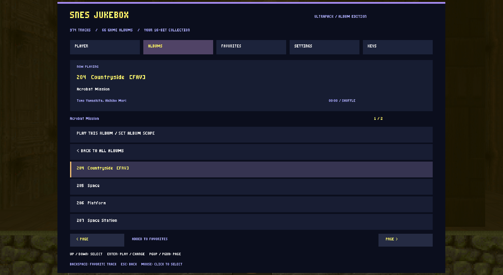

# SNES Jukebox Enhanced

An upgraded edition of **Cryomundus's SNES Jukebox UltraPack**, featuring **974 original SPC tracks across 66 game albums**, a dedicated TINYBABY-font menu, favorites, and expanded playback controls.

[Download the latest release](https://github.com/tuin-boop/SnesJukeBoxEnhanced/releases/latest) · [Original release thread](https://forum.zdoom.org/viewtopic.php?t=49073)



## Features

- Browse alphabetized game albums and play individual tracks.
- Save favorites and shuffle your favorites, one album, or the full collection.
- Shuffle without immediate repeats, sequential playback, and repeat-track mode.
- Next, previous, restart, stop, and restore the current map's music.
- Optional timed switching from 30 seconds to 15 minutes.
- Configure autoplay, map-change behavior, music volume, and switching sounds.
- Optional track notifications and a persistent now-playing HUD.
- Mouse, keyboard, standard controller menu navigation, and rebindable keys.
- Original `nextsong`, `origsong`, and `song <number>` commands retained.

## Install and play

1. Download `SNES-Jukebox-Album-Edition-v1.1.pk3` from Releases.
2. Load it with your IWAD and other mods in **UZDoom 4.14.3 or GZDoom 4.14+**.
3. Open **Options → SNES Jukebox – Albums**, or enter `snesjukebox` in the console.

This is a standalone replacement: do not also load the original UltraPack or another Album Edition version. Start a new game when upgrading from the original ACS-based jukebox.

**J** opens the menu if it was not already assigned. Stewie uses J for switching companions, so use the Options menu or assign another key in the jukebox's **KEYS** tab.

Use arrow keys and Enter to browse, Page Up/Down to change pages, and Backspace to toggle a favorite in track lists. Left/right changes settings. Escape returns to the album library or closes the menu.

SPC tracks loop by default. Auto-advance uses a selected time interval, not track-end detection. Previous moves backward in collection order, not listening history. “Same track” on map change restarts that song.

## Compatibility

Tested in **UZDoom 4.14.3**, including **Stewie-Brian-Arsenal v0.184 + Griffin Voxel Blood v0.23** with the jukebox loaded before and after those mods. v1.1 isolates script include paths to fix the `GVGoreMenu already exists` collision.

The mod changes local music playback and adds its own menu; it does not replace gameplay actors. GZDoom and multiplayer have not been tested separately. Zandronum is not supported by this edition.

## Credits

This project expands an existing jukebox and compilation. Credit for the original work belongs to:

- **Cryomundus** — original SNES UltraPack compilation and track information.
- **TerminusEST13** — standalone jukebox foundation.
- **CombineKegan** — original GMOTA jukebox foundation.
- **Bloax and TheToxicAvenger** — song gathering and information checking.
- **Mike12 and CookieJar** — song gathering.
- **Ryan Cordell** — original numbered-song command fix.
- **Marrub** — original ACS string handling and client-side music work.
- **Original game composers and rights holders** — all included music; composer information is displayed in the menu and retained in `original/LANGUAGE.txt`.
- **Zophar's Domain** — SPC archive credited by the original compilation.

The original author's complete credits are preserved in [original/info.txt](original/info.txt) and included in the playable PK3. See the [original release thread](https://forum.zdoom.org/viewtopic.php?t=49073).

Album Edition adds the browser, favorites, playback settings, and modern controller. Its TINYBABY font asset was reused from the author's local TuinDoomRPG mod. Original music and third-party assets remain the work of their respective creators; this repository does not claim ownership of them or grant new rights to them.

## Build from source

Requires Node.js and Windows PowerShell/.NET. Clone the repository, then run from its root:

```powershell
powershell -NoProfile -ExecutionPolicy Bypass -File tools/package.ps1
```

This generates `SNES-Jukebox-Album-Edition-v1.1.pk3`. The build checks that all 974 catalog entries have corresponding audio files. The repository includes the original audio needed to build; no separate download is required.

- `src/` — current menu, controller, settings, and private font.
- `src/snesjukebox/catalog.zs` — generated catalog.
- `original/` — original music, metadata, credits, and archived legacy scripts. The legacy controller is not loaded by the new package.
- `tools/` — catalog generator and packager.

See [README.txt](README.txt) for additional playback details. Local engine integration tests described there depend on the development machine and are not included in this repository.
